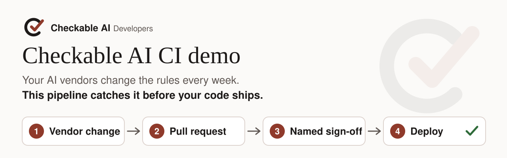
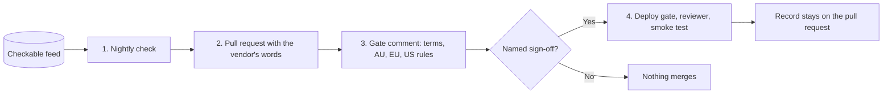

<p align="center">
  <picture>
    <source media="(prefers-color-scheme: dark)" srcset="docs/img/hero-dark.svg">
    
  </picture>
</p>

<p align="center">
  <a href="https://github.com/checkable-ai/ci-demo/actions/workflows/tests.yml"></a>
  
  
  
  
</p>

<p align="center">
  <a href="https://checkableai.com/developers/ci-demo/"><strong>Walkthrough and recording</strong></a>
  &nbsp;&middot;&nbsp;
  <a href="https://checkableai.com/enquire/"><strong>Make an enquiry</strong></a>
</p>

A vendor flips a default overnight. A developer points a service at a new AI plan on a Friday. Nobody reads the
terms, nobody checks the law, and six months later nobody can say who accepted the risk. This repository closes that
gap where your engineers already work: the pull request.

> [!NOTE]
> The demo runs for **Risky Business Solutions**, a fictional company. Every name, team and seat count is made up.
> The vendor changes, quotes, terms links and rules are real, taken from the Checkable feed.

## The problem it solves

- **Vendor changes land quietly.** On 26 Oct 2026 Google turned request storage on by default for new Gemini API
  paid projects. The same day GitHub made GPT-6.1 Terra the default in Copilot Business. Most teams find out
  late, if at all.
- **New AI tools slip in through code.** A one-line config change can move a service to another AI plan, with
  different terms and different Australian, EU and US rules, and still pass every test.
- **Nobody owns the decision.** When an auditor asks who approved it and why, the answer sits in someone's inbox, or
  nowhere.

## What the demo shows



1. **A change arrives.** Each night the check reads the Checkable feed. When a vendor change reaches a tool in the AI
   register, it opens a pull request that morning, with the vendor's own words and an email alert to the owner.
2. **A person decides.** Any pull request that touches an AI tool, a model config or a Kubernetes manifest gets one
   comment: the plan's terms, the AU, EU and US rules that apply, and every open vendor change on it. Nothing merges
   until a named person signs it off.
3. **Production waits for that sign-off.** After merge, a deploy gate matches the sign-off to the commit, a reviewer
   approves the production release, and a smoke test runs.
4. **The record stays.** The change, the source, the decision, the name and the date live on the pull request for
   good.

> [!TIP]
> It runs on GitHub-hosted runners and in your own cloud account. There is no Checkable server in the path and no
> API key to look after.

## Free sample, full feed

This repository is free to read, copy and run. It carries a snapshot of our demo feed, 7 AI plans and 5 real vendor
changes, which is enough to see every step work in your own pipeline.

The full feed is the same check, pointed at everything we track:

| | Free sample | Full feed, by enquiry |
|---|---|---|
| Vendor changes | 5, in a fixed snapshot | Every change we confirm, checked every day |
| AI platforms | 7 plans | 488 platforms and tools in our knowledge base |
| Pipelines | GitHub Actions | GitHub, Azure DevOps, GitLab and others |
| Where alerts go | Pull requests and email | Also Jira, ServiceNow, Teams and Slack |
| Set-up | You wire it in from this README | Our engineers fit it to your stack after a short assessment |

> [!IMPORTANT]
> Keeping a live feed right takes research every day and a person to confirm what changed, so the full feed is a
> paid service. **[Make an enquiry](https://checkableai.com/enquire/)** and tell us where your team works.

## Under the hood

The walkthrough, the recording and the technical steps are at https://checkableai.com/developers/ci-demo/, and
`docs/demo-script.md` walks through a full run step by step, including the recorded scenario. The sections below
hold the detail.

<details>
<summary><strong>How it is built</strong>: the four flows and the required checks</summary>

| Flow | Runs from | What it does |
|---|---|---|
| 1. Nightly check | `.github/workflows/checkable-nightly.yml` | Reads the feed, opens one pull request per vendor change that reaches the register, emails the alert |
| 2. Pull request gate | `checkable-gate.yml`, `checkable-sign-off.yml` | Checks register, model config and Kubernetes changes, posts one comment, holds `checkable/sign-off` until a person signs off |
| 3. Deploy | `terraform-plan.yml`, `deploy.yml`, `infra/` | Posts `terraform/plan` on every pull request. After merge, `checkable/deploy-gate` matches the sign-off, then `deploy` applies and smoke tests the service |
| 4. Kubernetes | `k8s-policy.yml`, `k8s/` | `k8s/policy` applies the manifests to a throwaway kind cluster on the runner and checks what it holds against the register |

A pull request that changes `service/` or `infra/` needs a sign-off even when no AI plan changed, because those files
reach production. A pull request that touches nothing the gate guards goes green straight away.

The ruleset on `main` requires a pull request and these four checks:

| Check | Published by |
|---|---|
| `tests` | `tests.yml` |
| `checkable/sign-off` | `checkable-gate.yml` and `checkable-sign-off.yml` (commit status) |
| `terraform/plan` | `terraform-plan.yml` |
| `k8s/policy` | `k8s-policy.yml` |

Each one reports on every pull request, so nothing waits on a check that never starts. Deploys have two more holds:
`checkable/deploy-gate` refuses any commit without a matching sign-off, including a direct push, and the `production`
environment waits for a member of `@checkable-ai/reviewers`. The deploy role trusts only that environment through
GitHub OIDC, so the repository holds no cloud keys.

</details>

<details>
<summary><strong>Install it in your repository</strong>: ten steps, from copying the workflows to the ruleset</summary>

1. Copy `.github/workflows/`, `.github/CODEOWNERS`, `scripts/`, `templates/` and `feed-snapshot/`.
2. Add `ai-vendor-register.yaml` at the root, one entry per AI tool with the feed's `plan` id, and an empty
   `changes/` folder with a `.gitkeep`. Put your name in `organisation` and set `fictional: false`.
3. Point each service at a register entry, in `service/<name>/model.yaml` (`vendor`, `product`, `plan`, `model`,
   `register_tool`) or with the Kubernetes annotations below.
4. Create a GitHub App for your organisation (Contents, Pull requests and Issues: read and write) and install it.
   Store `CHECKABLE_APP_ID` and `CHECKABLE_APP_PRIVATE_KEY` as secrets and set `CHECKABLE_BOT_LOGINS` to its bot
   login. Without the App the nightly check uses `GITHUB_TOKEN`, and GitHub then starts no workflow on its pull
   requests.
5. Keep default workflow permissions at read. Without the App, also tick "Allow GitHub Actions to create and approve
   pull requests".
6. Create the labels, or let the first run do it:

   ```sh
   gh label create ai-governance --color 0e8a16 --description "A vendor change from the Checkable feed"
   gh label create checkable-signed-off --color 1d76db --description "A person read the Checkable gate comment and signed this off"
   ```

7. Set `FEED_URL` to the feed address we give you. Until then every check reads `feed-snapshot/changes.json`.
8. Email is optional and sends from your own AWS account through Amazon SES. Add the GitHub OIDC provider
   (`token.actions.githubusercontent.com`, audience `sts.amazonaws.com`) and a role that trusts only your
   repository's `main` branch, with this policy and nothing else:

   ```json
   {
     "Version": "2012-10-17",
     "Statement": [{
       "Effect": "Allow",
       "Action": "ses:SendEmail",
       "Resource": "arn:aws:ses:<region>:<account-id>:identity/<your-domain>",
       "Condition": {
         "StringEquals": {"ses:FromAddress": "<sender>@<your-domain>"},
         "ForAllValues:StringEquals": {"ses:Recipients": ["<recipient>@<your-domain>"]},
         "Null": {"ses:Recipients": "false"}
       }
     }]
   }
   ```

   Store the role as `AWS_ROLE_ARN`, set `ALERT_TO`, `ALERT_FROM` and `AWS_REGION`, and put the same addresses in
   `ALLOWED_TO` and `ALLOWED_FROM` at the top of `scripts/checkable/alert.py`, which checks them again before
   sending. Without a role, the emails go to the job summary.
9. For the deploy flow, follow `infra/README.md`: plan and deploy roles through OIDC, a state bucket, and the
   variables `TF_PLAN_ROLE_ARN`, `TF_DEPLOY_ROLE_ARN` and `TF_STATE_BUCKET`. Create the `production` environment,
   limit it to `main` and add your reviewers.
10. Add a ruleset on `main` that requires a pull request and the four checks.

Want it fitted for you instead? Our engineers set it up for your stack after a short assessment:
https://checkableai.com/enquire/

</details>

<details>
<summary><strong>Settings</strong>: secrets and variables the workflows read</summary>

| Setting | Purpose |
|---|---|
| `CHECKABLE_APP_ID`, `CHECKABLE_APP_PRIVATE_KEY` (secrets) | The GitHub App the nightly check opens pull requests with |
| `CHECKABLE_BOT_LOGINS` | The App's bot login, so the gates accept what it posts (`checkable-ai[bot]` here) |
| `FEED_URL` | The feed address. Unset, the Actions read the snapshot in this repository |
| `ALERT_TO`, `ALERT_FROM` | Where the alert goes and who sends it |
| `AWS_ROLE_ARN` (secret), `AWS_REGION` | The role the alert job assumes through OIDC, and its region. A copy of this repository sends nothing until it sets its own |
| `TF_PLAN_ROLE_ARN`, `TF_DEPLOY_ROLE_ARN`, `TF_STATE_BUCKET` | The roles and state bucket for the deploy flow |

Each alert subject ends with its pull request number, for example "(PR #4)", so mail clients keep each one in its
own thread. GitHub pauses scheduled workflows after 60 days without a commit, so refresh
`feed-snapshot/changes.json` monthly to keep the nightly check running.

</details>

<details>
<summary><strong>How the gate reads a pull request</strong>: matching, sign-off and the Kubernetes annotations</summary>

The gate code and the feed come from the base commit, and the pull request's files are read through the GitHub API,
so nothing from the pull request runs. Each changed tool or config is matched to the feed by plan id, or by vendor
and product, and gets one section in a sticky comment. A plan the register does not list blocks sign-off until the
same pull request adds it.

A person with write access adds the `checkable-signed-off` label. The sign-off is recorded against that exact commit,
and any new commit clears it. Pull requests from forks stay red, because the sign-off has to come from inside the
repository.

Kubernetes manifests declare AI use with these annotations, or the same names as env entries or ConfigMap keys:

| Annotation | Env or ConfigMap key |
|---|---|
| `checkable.ai/vendor` | `CHECKABLE_AI_VENDOR` |
| `checkable.ai/product` | `CHECKABLE_AI_PRODUCT` |
| `checkable.ai/plan` | `CHECKABLE_AI_PLAN` |
| `checkable.ai/model` | `CHECKABLE_AI_MODEL` |
| `checkable.ai/register-tool` | `CHECKABLE_AI_REGISTER_TOOL` |

</details>

<details>
<summary><strong>The sample service and the tests</strong></summary>

`service/summariser/` is a small internal service, a Python 3.12 function with `GET /health` and `POST /summarise`.
It answers with a placeholder summary and the vendor, plan and model from `model.yaml`, and never calls an AI vendor,
so it costs next to nothing to run. `infra/README.md` lists every resource it creates.

`pip install -r scripts/requirements-dev.txt`, then `python -m pytest`. The tests cover the Action code, every
template, the deploy gate, the Kubernetes policy and the service.

</details>

## About the feed snapshot

`feed-snapshot/changes.json` follows `feed-snapshot/changes.schema.json`. Each plan carries its vendor terms links and
the AU, EU and US rule codes from our knowledge bases, and each change carries its evidence. A vendor quote appears
only where the source's licence allows it, and the licence is named on the quote. Otherwise the entry gives our
reading and the link. The rules and readings are Checkable AI's reading, not legal advice, so confirm them with your
adviser.

<p align="center">
  <a href="https://checkableai.com/developers/ci-demo/"><strong>Read the walkthrough</strong></a>
  &nbsp;&middot;&nbsp;
  <a href="https://checkableai.com/enquire/"><strong>Make an enquiry</strong></a>
</p>

Copyright Checkable AI. All rights reserved. Vendor quotes stay under their own licence, named on each quote.
